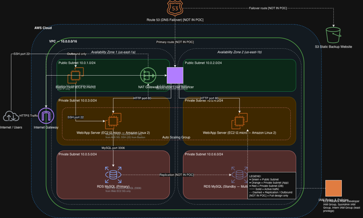

# Secure 3-Tier AWS Architecture: WinLocal Giveaways

A cloud migration design and proof of concept (PoC) for **WinLocal Giveaways**, a fictional Dublin-based start-up running online contests. The project moves the company off an ageing on-premises setup and onto a secure, scalable, cloud-native 3-tier architecture on **Amazon Web Services (AWS)**.

> Built as part of the *Security Architecture* module (Year 3, BSc Digital Forensics & Cybersecurity, TU Dublin).

---

## The Problem

WinLocal's on-premises environment (NetScaler load balancer, Windows Server 2016 + IIS, Microsoft SQL Server) had four core issues:

| # | Issue | Impact |
|---|-------|--------|
| 1 | Ageing load balancer, single point of failure | Frequent service outages |
| 2 | Unmanaged SQL Server database growth | Disk space exhaustion, manual upkeep |
| 3 | No automatic scaling | Couldn't handle traffic spikes during contests |
| 4 | Flat, unsegmented network | A ransomware infection went undetected for **10 weeks** |

## The Solution

A 3-tier architecture across **two Availability Zones** (us-east-1a / us-east-1b) inside a custom VPC (`10.0.0.0/16`), built under a **$50 budget**.

### Network design

| Tier | Subnets | Resources |
|------|---------|-----------|
| **Public** | `10.0.1.0/24`, `10.0.2.0/24` | Application Load Balancer, Bastion Host, NAT Gateway |
| **Application** (private) | `10.0.3.0/24`, `10.0.4.0/24` | EC2 web servers in an Auto Scaling Group |
| **Database** (private) | `10.0.5.0/24`, `10.0.6.0/24` | Amazon RDS MySQL |

### How each issue was solved

| Issue | AWS solution |
|-------|--------------|
| 1. Load balancer failures | **Application Load Balancer** across 2 AZs + **S3 static failover site** (with Route 53 DNS failover proposed) |
| 2. Database management | **Amazon RDS MySQL** with automated backups (Multi-AZ recommended for production) |
| 3. Manual scaling | **Auto Scaling Group** (min 1 / max 2) using a target-tracking policy at 60% CPU, launched from a custom AMI |
| 4. Flat network / ransomware | **VPC segmentation**, a **bastion host** jump-box, and layered **security groups** (+ AWS WAF proposed) |

## Security Design

Security follows **defence in depth** and the **principle of least privilege**. Each tier has its own security group, and rules reference *other security groups* instead of IP ranges, so they stay valid as instances scale in and out.

| Security group | Attached to | Allows inbound | From |
|---|---|---|---|
| ALB SG | Application Load Balancer | HTTP 80, HTTPS 443 | Internet |
| Bastion SG | Bastion Host | SSH 22 | Administrator IP only |
| Web SG | Web servers (ASG) | HTTP 80 | ALB SG only |
| Web SG | Web servers (ASG) | SSH 22 | Bastion SG only |
| RDS SG | RDS MySQL | MySQL 3306 | Web SG only |

Even if an attacker compromises a web server, it can only reach the database on port 3306. Web servers have **no public IPs** and can only be administered through the bastion host.

## Proof of Concept: What Was Built & Tested

Custom VPC with 6 subnets across 2 AZs, Internet Gateway, NAT Gateway and route tables
Bastion host with SSH jump-host access to private instances Custom AMI → Launch Template → Auto Scaling Group
**Auto scaling verified**: used `stress` to push CPU above 60%, which triggered a CloudWatch alarm and a scale-out event
**Load balancing verified**: refreshing the ALB URL showed requests served by different instance IDs
RDS MySQL in isolated DB subnets, connected to a sample web app
S3 static website as a maintenance/failover page

### Proposed (designed, outside PoC scope)
- **AWS WAF**: OWASP Top 10 managed rules in front of the ALB, plus request logging for an audit trail
- **Route 53 DNS failover**: automatic switch to the S3 maintenance page if the ALB health check fails
- **RDS Multi-AZ**: removes the database as a single point of failure

## Sustainability (AWS Well-Architected)

- Auto scaling avoids idle instances, unlike the old fixed-capacity on-prem setup
- Managed services (RDS, ALB) run on shared, optimised AWS infrastructure
- Right-sized instances (`t2.micro`, `db.t3.micro`)
- Recommendations: Graviton (ARM) instances, S3 Intelligent-Tiering, Lambda for event-driven tasks

## Frameworks Referenced

- **AWS Well-Architected Framework** (Security, Reliability and Sustainability pillars)
- **NIST Cybersecurity Framework 2.0**: maps WinLocal's security posture, with Detect and Govern identified as the priority areas for investment

## Tech & Tools

`AWS VPC` · `EC2` · `Auto Scaling` · `Application Load Balancer` · `RDS (MySQL)` · `S3` · `CloudWatch` · `IAM` · `Security Groups` · `NAT Gateway` · `Route 53` · `AWS WAF` · `draw.io` · `Linux`

## Note

All resources ran in a temporary AWS Academy Learner Lab environment and have since been shut down. Account identifiers and IP addresses have been removed from the report.

---

**Author:** Alya Khalil · [LinkedIn](https://www.linkedin.com/in/alya-khalil-10b755337/)
